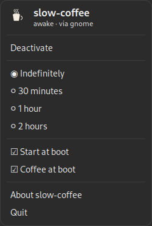

<div align="center">

# ☕ slow-coffee

**A take-your-time keep-awake indicator for your system tray. On by default.**

A small coffee cup lives in your top bar and stops the screen blanking or the
session going idle. The cup boots *full*, because the whole point is to stay
awake until you say otherwise. No daemon to babysit, no battery to drain - it
just holds a D-Bus idle inhibitor and gets out of the way.

[](https://github.com/PLNech/slow-coffee/actions/workflows/ci.yml)
[](https://pypi.org/project/slow-coffee/)
[](https://aur.archlinux.org/packages/slow-coffee)
[](LICENSE)



</div>

## Why another caffeine?

Most keep-awake tools assume you want a *trigger*: stay awake while a video
plays, while music plays, while an app is fullscreen. slow-coffee assumes the
opposite. You opened it because you want to stay awake **now**, so it starts
caffeinated and stays that way. One click (or a timer) to stop.

- **On by default.** Cup full at launch. `--start-inactive` if you disagree.
- **Honest icon.** Full = really inhibiting; empty = really not. No lying cup.
- **Idle-only by default.** The screen stays on, but closing the lid still
  suspends - safer for a laptop than blocking all sleep.
- **Timers.** 30 min / 1 hour / 2 hours / indefinitely, from the menu or
  `--minutes N`.
- **Self-contained.** Bundles its own icons; no theme or extra data package.

## Install

slow-coffee needs the GObject introspection runtime (GTK 3 + Ayatana
AppIndicator). On a tray that hides AppIndicators (e.g. vanilla GNOME), enable
the *AppIndicator support* extension.

### Arch (AUR)

```sh
yay -S slow-coffee          # or: paru -S slow-coffee
```

### Debian / Ubuntu (.deb)

Grab `slow-coffee_*.deb` from the [latest release](https://github.com/PLNech/slow-coffee/releases) and:

```sh
sudo apt install ./slow-coffee_1.0.0_all.deb
```

### pip (PyPI)

The GIR libraries come from your distro, the rest from pip:

```sh
# Debian/Ubuntu
sudo apt install python3-gi gir1.2-gtk-3.0 gir1.2-ayatanaappindicator3-0.1
# Fedora
sudo dnf install python3-gobject gtk3 libayatana-appindicator-gtk3

pip install --user slow-coffee
slow-coffee --install-desktop      # add it to your applications menu (no root)
```

### From source

```sh
git clone https://github.com/PLNech/slow-coffee
cd slow-coffee
sudo make install                  # PREFIX=/usr/local by default
```

## Usage

Run `slow-coffee` (or launch **Slow Coffee** from your applications menu). The
cup appears in the tray, already caffeinated. Click it for the menu:

| Item | Does |
|------|------|
| Activate / Deactivate | Toggle the inhibitor by hand |
| Indefinitely / 30 min / 1 h / 2 h | Pick a duration; it auto-stops when time is up |
| Start at boot | Add/remove the autostart entry - launch slow-coffee at login |
| Coffee at boot | When autostarted, boot caffeinated (off = boot decaf) |
| About / Quit | The usual |

**Start at boot** and **Coffee at boot** are the checkbox equivalents of
`--autostart` and `--start-inactive`: the first writes (or removes) the
autostart `.desktop` entry, the second decides whether that entry launches
caffeinated. They configure the *next* login, not the running cup, and the
"coffee at boot" choice is remembered in `~/.config/slow-coffee/settings.json`.

```sh
slow-coffee                  # start caffeinated, forever
slow-coffee --minutes 90     # caffeinated for 90 minutes, then off
slow-coffee --start-inactive # start decaf; toggle on from the tray
slow-coffee --install-desktop --autostart   # menu entry + start at login
slow-coffee --uninstall-desktop             # undo the above
```

## How it works

slow-coffee asks the session to not go idle, preferring whatever is actually
running and falling back gracefully:

1. **`org.gnome.SessionManager.Inhibit`** (flag `8`, idle) - GNOME.
   *X11 verified; GNOME-Wayland expected but untested by the author.*
2. **`org.freedesktop.ScreenSaver.Inhibit`** - KDE and other freedesktop shells.
3. **`systemd-inhibit --what=idle`** - logind fallback for bare window managers.

It holds one persistent session-bus connection and releases the inhibitor on
quit. It does **not** add the "suspend" flag, so lid-close still sleeps. Wayland
note: the idle-inhibit protocol is per-surface, so a global manual inhibitor is
shell-dependent; under GNOME the SessionManager call covers it, under wlroots
your mileage varies and the `systemd-inhibit` fallback handles sleep.

## Prior art

This is an independent implementation, written from scratch, but it stands on
the shoulders of two lovely projects worth knowing:

- [caffeine](https://launchpad.net/caffeine) by Reuben Thomas - the classic
  fullscreen-auto daemon + manual indicator (GPL-3, X11).
- [caffeine-ng](https://codeberg.org/WhyNotHugo/caffeine-ng) by Hugo Barrera -
  the modern rewrite with presentation-mode and audio awareness.

slow-coffee differs by being *on by default*, using D-Bus inhibition (rather
than an unmapped X window), shipping as a single self-contained package, and
living under MIT.

## Development

```sh
python3 -m slow_coffee            # run from a checkout (needs system PyGObject)
python3 make_icons.py             # regenerate the cup icons (needs Pillow)
/usr/bin/python3 docs/render_menu.py docs/menu.png   # re-render the screenshot
```

## License

[MIT](LICENSE) (c) 2026 PLNech.
